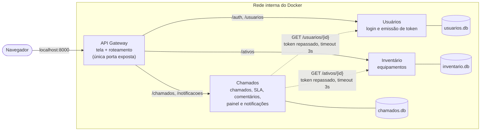

# HelpDesk TI em microsserviços

🎥 **Vídeo de demonstração:** https://youtu.be/NtJNhwjqp3I

Trabalho da disciplina de Arquitetura de Software (Prof. Filipe Cavalcante): transformação do
monólito HelpDesk TI em microsserviços, mantendo as mesmas funcionalidades e a mesma segurança.

## Arquitetura



| Serviço | Rotas | Banco |
|---|---|---|
| **gateway** | `/` (tela), `/saude` e repasse de todas as rotas abaixo | nenhum |
| **usuarios** | `/auth/login`, `/auth/eu`, `/usuarios` | `usuarios.db` |
| **inventario** | `/ativos` | `inventario.db` |
| **chamados** | `/chamados`, `/notificacoes` | `chamados.db` |

## Como rodar

Requisito: Docker com Docker Compose.

```bash
cp .env.example .env
# gere um segredo e coloque em JWT_SEGREDO no .env:
python3 -c "import secrets; print(secrets.token_urlsafe(48))"

docker compose up --build
```

Acesse **http://localhost:8000**.

Contas de exemplo (senha `Helpdesk2026`): `admin@empresa.com` (admin), `carla@empresa.com` e
`diego@empresa.com` (técnicos), `ana@empresa.com` e `bruno@empresa.com` (solicitantes).

Para ver quais serviços estão no ar: `curl localhost:8000/saude`.

## Testes

Cada serviço tem os próprios testes, que também rodam no GitHub Actions (um job por serviço):

```bash
cd servicos/usuarios   && pytest -q
cd servicos/inventario && pytest -q
cd servicos/chamados   && pytest -q
```

## Decisões

1. **Divisão dos serviços.** Segui os módulos que já existiam no monólito. O login ficou no
   serviço de Usuários, porque depende da tabela de usuários.
2. **Um banco por serviço.** Cada serviço tem o próprio SQLite em um volume separado. As chaves
   estrangeiras entre serviços (`solicitante_id`, `tecnico_id`, `ativo_id`, `autor_id`) viraram
   apenas números. A FK entre `comentarios` e `chamados` continua, porque as duas tabelas estão no
   mesmo serviço.
3. **Autenticação pelo token.** Só o serviço de Usuários emite tokens. Os outros apenas conferem
   a assinatura com o mesmo `JWT_SEGREDO` e leem o `id` e o `perfil` do próprio token, sem
   consultar o banco de outro serviço. Por isso, o `JWT_SEGREDO` passou a ser **obrigatório**: no
   monólito, sem ele era gerado um segredo aleatório, o que faria cada serviço usar um segredo
   diferente.
4. **Comunicação e falhas.** Chamados consulta Usuários e Inventário por HTTP (`app/clientes.py`),
   repassando o token do usuário no cabeçalho `Authorization`, com tempo limite de 3 segundos. Se
   o outro serviço estiver fora do ar, a resposta é **503** com uma mensagem clara. A listagem e o
   painel usam só o banco de Chamados e continuam funcionando.
5. **Gateway.** É um pequeno FastAPI com `httpx`, que serve a tela e repassa cada rota pelo
   primeiro trecho do caminho. Só ele publica porta, e apenas em `127.0.0.1`.
6. **Notificações.** Continuam dentro do serviço de Chamados, como no monólito.
7. **Dados de exemplo.** Cada serviço cria só os seus. Os ids precisam bater entre eles
   (ana = 2, carla = 4, PAT-0001 = 1).
8. **Segurança do contêiner.** Foram mantidas as proteções do monólito em todos os serviços:
   usuário não-root, `read_only`, `cap_drop: ALL` e `no-new-privileges`.

## O que mudou em relação ao monólito

**O que melhorou:** cada serviço pode ser construído, publicado e reiniciado sozinho. Uma falha
no Inventário não derruba os chamados. Cada time cuida do seu código e do seu banco.

**O que ficou mais difícil:**
- agora existe a rede no meio, com latência, timeouts e falhas parciais para tratar;
- não há mais JOIN nem chave estrangeira entre serviços: se um equipamento for apagado, um
  chamado pode continuar apontando para ele;
- um usuário desativado continua com acesso até o token expirar (60 minutos), porque os serviços
  não consultam mais o banco de usuários a cada requisição;
- testar ficou mais trabalhoso: em Chamados, os outros serviços são simulados nos testes;
- há mais contêineres para subir, monitorar e manter.